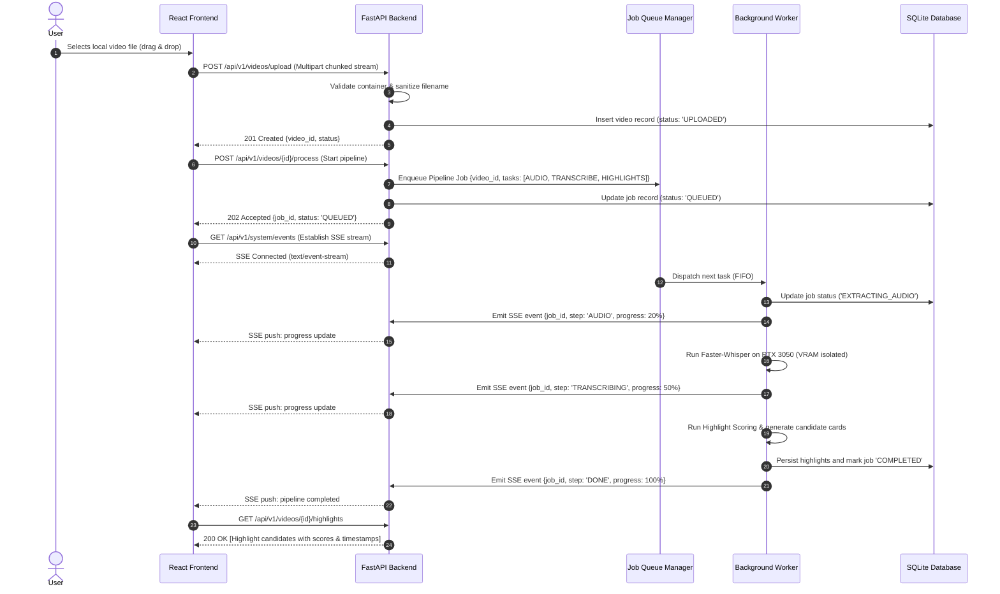
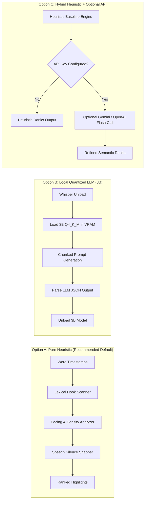
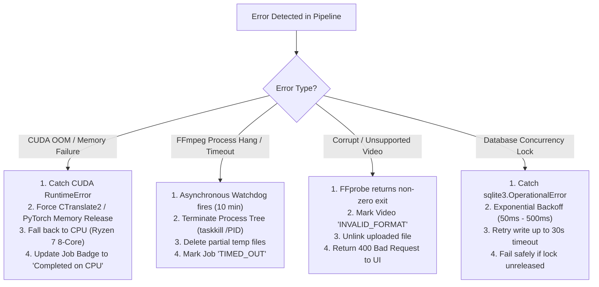

# System Architecture & Hardware Strategy

**Project Name:** AI Video Clipper (Working Title: Clipsly)  
**Document Version:** 1.0.0  
**Status:** APPROVED & FINALIZED (Phase 02 Architecture Baseline)  
**Author:** Senior Software Architect, AI Systems Engineer & GPU Optimization Specialist  
**Target Hardware:** ASUS TUF A15 (AMD Ryzen 7 7000 Series, NVIDIA GeForce RTX 3050 Laptop GPU, 4GB GDDR6 VRAM, 16GB DDR5 RAM, NVMe SSD)  

---

## 1. Executive Architectural Summary

Clipsly is a sovereign, local-first multimedia desktop web application engineered to convert long-form horizontal video recordings into captioned, 9:16 vertical short-form clips. 

The architecture is governed by a foundational physical constraint: **operating reliably within the 4GB GDDR6 VRAM limit of an NVIDIA GeForce RTX 3050 Laptop GPU under Windows 11**. Under standard operating conditions, the Windows Desktop Window Manager (DWM) and system display drivers consume approximately 500MB to 600MB of VRAM, leaving approximately **3.4 GB to 3.5 GB of usable VRAM**.

To eliminate the risk of GPU Out-Of-Memory (OOM) crashes, driver timeouts (TDR), and system stutter, Clipsly adopts a **Strict Sequential Processing Lifecycle** combined with an **In-Process SQLite-Backed Asyncio Job Queue** and **Subprocess-Isolated Media Execution**. Heavy workloads—audio extraction, AI speech transcription, highlight analysis, video cutting, 9:16 vertical filtergraph processing, and NVENC hardware video encoding—are executed as isolated, non-overlapping sequential pipeline stages.

---

## 2. Overall System Architecture

The following diagram illustrates the high-level architecture of Clipsly, showing process boundaries, transport protocols, and data flow across client, server, AI, and storage tiers:

```mermaid
graph TD
    subgraph ClientLayer["Client Layer (Browser - Localhost:5173)"]
        UI["React 18 + Vite SPA"]
        Components["shadcn/ui + Tailwind CSS"]
        Player["HTML5 Video Player + Canvas Subtitle Overlay"]
        SSEClient["EventSource (SSE Client)"]
    end

    subgraph ServerLayer["Server Core (FastAPI - 127.0.0.1:8000)"]
        Router["FastAPI REST Router (v1)"]
        SSEStreamer["SSE Progress Broadcast Manager"]
        JobManager["Job Queue Manager (asyncio.Queue)"]
        Worker["Sequential Worker Dispatcher"]
    end

    subgraph DataLayer["Storage & State Layer (Local SSD)"]
        SQLite[("SQLite 3 Database (WAL Mode)<br/>data/clipsly.db")]
        FileStore["Local File Store<br/>storage/{uploads,audio,clips,subtitles,exports}"]
    end

    subgraph ExecutionLayer["Subprocess & Compute Layer (OS Level)"]
        FFprobeProc["FFprobe Process (Metadata Extraction)"]
        FFmpegAudio["FFmpeg Process (16kHz WAV Extraction)"]
        WhisperProc["Faster-Whisper Subprocess / Runner (CTranslate2 / CUDA)"]
        HighlightEngine["Highlight Detection Service (Heuristic / Optional API)"]
        FFmpegRender["FFmpeg Process (NVENC h264_nvenc + libass)"]
    end

    UI -->|HTTP POST / GET| Router
    Player -->|HTTP 206 Partial Content Stream| Router
    SSEStreamer -->|text/event-stream| SSEClient
    Router -->|Enqueue Job| JobManager
    JobManager -->|State Persist| SQLite
    Worker -->|Fetch Next Job| JobManager
    Worker -->|Broadcast Progress| SSEStreamer

    Worker -->|Inspect File| FFprobeProc
    Worker -->|Extract Audio| FFmpegAudio
    Worker -->|Transcribe (Sequential)| WhisperProc
    Worker -->|Score Highlights| HighlightEngine
    Worker -->|Cut & Render (NVENC)| FFmpegRender

    FFprobeProc -->|JSON Stream| Worker
    FFmpegAudio -->|Write .wav| FileStore
    WhisperProc -->|Tokens & Words| SQLite
    FFmpegRender -->|Write Final .mp4| FileStore
    Router -->|Read Metadata| SQLite
```

---

## 3. Component Architecture Breakdown

### 3.1 Frontend Architecture (React + Vite + TypeScript)
- **Framework & Bundler:** React 18, Vite 5, TypeScript 5 (Strict Mode enabled, `noImplicitAny: true`).
- **Styling & UI Primitives:** Tailwind CSS v3.4+, `shadcn/ui` components (Radix UI unstyled primitives), Lucide Icons.
- **State Management:**
  - *Server State:* Lightweight custom fetch hooks with SWR-style caching for video and clip listings.
  - *Active Studio State:* React Context / Zustand store managing active clip boundaries (`start_ms`, `end_ms`), subtitle styling parameters, and live video seek synchronizer.
  - *Progress & Telemetry:* `useSSE` hook maintaining a persistent `EventSource` connection to `GET /api/system/events`.
- **Media Presentation Strategy:**
  - Standard HTML5 `<video>` element consuming backend HTTP 206 range streams.
  - Zero-latency client-side preview for video trimming: video is masked to 9:16 using CSS viewport bounding; subtitles are rendered live via an overlaid HTML5 `<canvas>` or synced DOM layer, avoiding costly server-side proxy rendering.

### 3.2 Backend Architecture (FastAPI + Python 3.10+)
- **Application Server:** FastAPI running atop Uvicorn ASGI server bound strictly to `127.0.0.1:8000`.
- **API Organization:** Modular versioned routing (`/api/v1/videos`, `/api/v1/transcripts`, `/api/v1/highlights`, `/api/v1/clips`, `/api/v1/exports`, `/api/v1/system`).
- **Data Validation & Serialization:** Pydantic v2 schemas for all request payloads and response envelopes.
- **Database Access:** SQLAlchemy 2.0 with asynchronous engine (`aiosqlite`) and session factory.
- **Subprocess Execution Manager:** Centralized `SafeSubprocessRunner` executing all external CLI binaries (FFmpeg, FFprobe) using structured argument lists with timeout watchdogs and non-blocking `asyncio` stream reading.

### 3.3 Database Architecture (SQLite 3 WAL)
- **Engine:** SQLite 3 via `aiosqlite`.
- **Location:** `data/clipsly.db` on local SSD.
- **Concurrency & Locking Optimization:**
  - `PRAGMA journal_mode=WAL;` (Write-Ahead Logging allows concurrent readers while background worker writes).
  - `PRAGMA synchronous=NORMAL;` (Optimal SSD write performance without integrity compromise).
  - `PRAGMA busy_timeout=30000;` (30-second wait on table locks before throwing errors).
  - `PRAGMA foreign_keys=ON;` (Relational integrity enforced).

---

## 4. Frontend-Backend Communication & API Lifecycle



---

## 5. End-to-End Video Processing Pipeline (14-Stage Detail)

The media pipeline executes across 14 deterministic stages:

```
[1. Ingestion] ──> [2. Metadata Probing] ──> [3. Audio Extraction] ──> [4. Audio Preprocessing]
       │
       ▼
[5. Speech Transcription] ──> [6. Transcript Segmentation] ──> [7. Highlight Detection]
       │
       ▼
[8. Highlight Scoring] ──> [9. Timestamp Snapping] ──> [10. Clip Slicing] ──> [11. 9:16 Re-framing]
       │
       ▼
[12. Subtitle Compilation] ──> [13. NVENC Export] ──> [14. Verification & Cleanup]
```

| Stage | Process / Component | Input | Output | Memory / Resource Impact |
|---|---|---|---|---|
| **1. Video Ingestion** | FastAPI Streaming Handler | Binary upload stream | `/storage/uploads/{id}.mp4` | $< 50\text{MB}$ RAM (chunked buffer) |
| **2. Metadata Extraction** | `ffprobe` Subprocess | Uploaded video path | JSON metadata (duration, FPS, codecs) | $< 20\text{MB}$ RAM, instantaneous |
| **3. Audio Extraction** | `ffmpeg` Subprocess | Uploaded video | `/storage/audio/{id}_raw.wav` | $< 50\text{MB}$ RAM, CPU stream copy |
| **4. Audio Preprocessing** | `ffmpeg` Subprocess | Raw audio WAV | `/storage/audio/{id}_16k.wav` (Mono 16kHz PCM) | $< 30\text{MB}$ RAM, fast resample |
| **5. Speech Transcription** | Faster-Whisper (CUDA) | 16kHz Mono WAV | Raw tokens, word timestamps | **~800MB–1.2GB VRAM** (`small` model) |
| **6. Segmentation** | Backend Parsing Service | Word timestamp tokens | Sentence objects with silence markers | $< 50\text{MB}$ RAM, pure CPU |
| **7. Highlight Detection** | Highlight Engine Service | Sentence objects | Sliding candidate windows ($15\text{s}–90\text{s}$) | $< 50\text{MB}$ RAM, pure CPU |
| **8. Highlight Scoring** | Heuristic / Optional API | Candidate windows | Scored candidates ($0–100$ scale) | $< 50\text{MB}$ RAM, pure CPU |
| **9. Timestamp Snapping** | Boundary Alignment Service | Raw highlight windows | Snapped windows ($+0.5\text{s}$ pause padding) | Negligible, pure CPU |
| **10. Clip Slicing** | `ffmpeg` Subprocess | Source video + timestamps | Intermediate sub-clip | CPU stream copy, fast disk I/O |
| **11. 9:16 Re-framing** | `ffmpeg` Complex Filtergraph | Intermediate sub-clip | 1080x1920 canvas (blur/crop) | GPU NVENC session initialized |
| **12. Subtitle Compilation**| Subtitle Generator Service | Highlight words + styling | `/storage/subtitles/{id}.ass` | Negligible, pure CPU |
| **13. Final Rendering** | `ffmpeg` (`h264_nvenc` + `libass`) | 9:16 video + ASS script | `/storage/exports/{id}.mp4` | **~450MB–600MB VRAM**, NVENC encoder |
| **14. Cleanup & Verify** | Storage Watchdog Service | Temp files | Purged temp clips, validated final MP4 | SSD space reclaimed |

---

## 6. GPU and Hardware Strategy (ASUS TUF A15 / RTX 3050 4GB)

### 6.1 Physical Hardware Constraints
- **Host Laptop:** ASUS TUF A15
- **CPU:** AMD Ryzen 7 7000 Series (8 Cores, 16 Threads, up to 4.7GHz) — Exceptional multi-core performance for parallel CPU audio extraction and fallback encoding.
- **GPU:** NVIDIA GeForce RTX 3050 Laptop GPU (Ampere GA107 architecture).
- **Physical VRAM:** **4,096 MB (4 GB) GDDR6.**
- **System RAM:** 16 GB DDR5.
- **Storage:** NVMe PCIe M.2 SSD.

### 6.2 Realistic VRAM Budget Allocation Under Windows 11

Under Windows 11, the operating system never grants 100% of physical VRAM to a single compute task. The table below represents estimated allocations based on hardware specifications and GPU driver behavior:

```
┌────────────────────────────────────────────────────────────────────────┐
│ Total Physical VRAM: 4,096 MB (4.0 GB)                                 │
├───────────────────┬───────────────────┬────────────────────────────────┤
│ Allocation Tier   │ VRAM Budget       │ Purpose / Component            │
├───────────────────┼───────────────────┼────────────────────────────────┤
│ OS & Display Base │ ~500 MB – 650 MB  │ Windows DWM, display driver,   │
│ (Permanent)       │                   │ browser hardware acceleration  │
├───────────────────┼───────────────────┼────────────────────────────────┤
│ Usable Budget     │ ~3,446 MB – 3,596 MB (Target Max Cap: 3,200 MB)   │
├───────────────────┼───────────────────┼────────────────────────────────┤
│ Safety Cushion    │ ~500 MB           │ Prevents OS TDR driver reset   │
├───────────────────┼───────────────────┼────────────────────────────────┤
│ Max Allocation    │ ~2,700 MB – 3,000 MB for any active workload      │
└───────────────────┴───────────────────┴────────────────────────────────┘
```

*Note: All memory values listed in this document are design budget estimates based on hardware specifications and will be empirically verified and benchmarked during Phase 19 testing.*

### 6.3 Workload VRAM Consumption Estimates

| Pipeline Task | Engine / Component | Estimated VRAM | CPU Fallback Available? | Concurrency Rule |
|---|---|---|---|---|
| **Transcription (`base`)** | Faster-Whisper (`float16`) | ~250 MB – 350 MB | Yes (`device="cpu"`) | Run standalone |
| **Transcription (`small`)** | Faster-Whisper (`float16`) | ~750 MB – 1,100 MB | Yes (`device="cpu"`) | **Recommended Default**; standalone |
| **Transcription (`medium`)**| Faster-Whisper (`int8_float16`) | ~1,600 MB – 2,100 MB | Yes (`device="cpu"`) | High memory risk; strictly isolated |
| **Highlight Detection** | Deterministic Heuristic Engine | **0 MB (CPU only)** | Native CPU | Runs concurrently with nothing |
| **Clip Slicing** | FFmpeg stream copy (`-c copy`) | **0 MB (CPU/Disk)** | Native CPU | No VRAM impact |
| **NVENC Video Export** | FFmpeg (`h264_nvenc` + `libass`) | ~400 MB – 600 MB | Yes (`libx264` CPU) | Single export session only |

### 6.4 The Strict Sequential Processing Rule

```
[Faster-Whisper Inference] ──> [Explicit Model Unload & GC] ──> [NVENC Video Render Session]
     (Max ~1.1GB VRAM)               (VRAM drops to 0MB)             (Max ~600MB VRAM)
```

> [!CAUTION]
> **Zero Model Co-Existence Policy:**
> Faster-Whisper and FFmpeg NVENC must **never** run in parallel.
> 1. Faster-Whisper executes transcription.
> 2. The Python model reference is explicitly deleted (`del model`).
> 3. Python garbage collection (`gc.collect()`) and CTranslate2/CUDA cache clear is triggered.
> 4. Only after VRAM has returned to baseline does FFmpeg initiate NVENC hardware encoding.

### 6.5 FFmpeg Hardware Acceleration Strategy
- **Video Decoding:** We explicitly use **Software Decoding (`libavcodec` on CPU)** feeding into the NVENC hardware encoder, rather than full CUDA hardware decoding (`-hwaccel cuda`).
  - *Rationale:* Applying complex video filtergraphs (such as `boxblur=25:5`, scaling, and `libass` subtitle burning) inside pure CUDA memory requires specialized CUDA filter surfaces (`scale_cuda`, `yadif_cuda`) which lack robust Gaussian blur and font rasterization support in standard FFmpeg builds.
  - Software decoding on the 8-core AMD Ryzen 7 7000 Series CPU is blazingly fast ($> 150\text{ FPS}$ for 1080p), allowing standard filtergraphs (`boxblur`, `ass`) to process frames in host RAM and stream them directly to the NVENC encoder hardware chip (`h264_nvenc`) with minimal VRAM overhead (~450MB).

### 6.6 Automatic CPU Fallback Mechanism
If CUDA initialization fails, or if VRAM free memory is measured at $< 600\text{MB}$ prior to a task:
1. **Whisper:** Re-instantiates on CPU using `device="cpu"`, `compute_type="int8"`, and `cpu_threads=8`.
2. **Video Export:** Switches FFmpeg encoder from `h264_nvenc` to `libx264` with `preset="fast"`, `crf=22`, and `threads=8`.
3. **User Notification:** Dispatches an informational SSE telemetry badge: *"GPU memory constrained; switched to multi-core CPU mode."*

---

## 7. AI Highlight Detection Architecture Evaluation

Three architectural candidates were systematically analyzed for the highlight detection engine:



### Comprehensive Candidate Comparison Matrix

| Evaluation Criterion | Approach A: Deterministic Heuristic | Approach B: Local Quantized LLM (3B) | Approach C: Hybrid Heuristic + Optional API |
|---|---|---|---|
| **Hardware Requirements** | **0 MB VRAM**, minimal CPU ($< 5\%$ of Ryzen 7) | **~1.8GB – 2.2GB VRAM** (Q4_K_M via llama.cpp) | **0 MB VRAM** (Local CPU + optional TLS call) |
| **4GB VRAM Safety** | **100% Safe:** Zero VRAM footprint | **High Risk:** Leaves $< 800\text{MB}$ safety headroom | **100% Safe:** Zero local GPU memory load |
| **Accuracy / Engagement** | **Good:** Excellent for high-energy hooks, pauses, pacing | **Very High:** Strong semantic discourse reasoning | **Superior:** Cloud LLMs provide state-of-the-art reasoning |
| **Processing Time** | **$< 2\text{ seconds}$** for a 60-minute transcript | 45–90 seconds (prompt chunking & generation) | $< 2\text{s}$ (heuristic) or 3–6s (cloud API) |
| **Cost** | **$0.00** | **$0.00** | $0.00 default; $<\$0.001$ per video if user uses API |
| **Privacy / Sovereignty** | **100% Private & Sovereign:** Never leaves laptop | **100% Private & Sovereign:** Fully offline | **100% Private by default;** optional API opt-in |
| **Implementation Complexity** | Low / Moderate (Clean Python regex & heuristics) | High (Ollama/llama-cpp binding, JSON validation) | Moderate (Clean fallback pattern) |
| **Reliability & Determinism**| **100% Deterministic:** Zero hallucinations | Moderate: Risk of invalid JSON or dropped timestamps| **High:** Guaranteed fallback to heuristic on network failure |

### Architecture Recommendation:
**Selected: Approach C — Hybrid Architecture with Heuristic-First Default.**
- **Default Operation:** The application ships with a production-grade **Deterministic Heuristic Engine** as the baseline. It runs entirely on the CPU in $< 2\text{ seconds}$, consumes zero VRAM, costs nothing, works 100% offline, and never hallucinates timestamps or crashes.
- **Optional Enhancement:** In the application Settings page, the user can optionally input an external API key (e.g., Google Gemini 1.5 Flash or OpenAI GPT-4o-mini). If configured, the highlight service sends the transcript text for advanced narrative evaluation while keeping the local GPU completely unburdened. If no key is provided or the machine is offline, the system seamlessly uses the local heuristic engine.
- *Rejection of Approach B:* Attempting to run a local 3B LLM inside a 4GB VRAM GPU on Windows 11 while managing Faster-Whisper and NVENC creates unacceptable crash risks, requires downloading multi-gigabyte GGUF models, and slows down the user workflow significantly.

---

## 8. Background Job Architecture

Long-running video processing operations must be handled asynchronously to prevent HTTP request timeouts and UI freezing.

### Architectural Evaluation of Task Runners

| Framework | Overhead | Windows 11 Suitability | Persistence Across Restarts | Verdict |
|---|---|---|---|---|
| **FastAPI `BackgroundTasks`** | Minimal | High | **No** (In-memory only; vanishes on restart) | Rejected: Cannot pause, resume, or survive reload |
| **Celery + Redis** | Heavy | **Very Poor** (Redis requires WSL/Docker on Windows) | Yes | **Rejected:** Unnecessary infrastructure overhead |
| **Dedicated Worker Subprocess** | Moderate | Moderate (Windows IPC pickling friction) | Partial | Rejected: Over-complicated for single user |
| **SQLite-Backed Asyncio Queue** | **Minimal** | **Native** (Runs in FastAPI lifespan loop) | **Yes** (Job state & progress persisted in SQLite) | **SELECTED (Optimal for Single-User Local Tool)** |

### Selected Architecture: SQLite-Backed Asyncio Job Queue
The system implements a custom, lightweight, robust asynchronous job queue:
1. **Storage & Durability:** Jobs are persisted in the SQLite `export_jobs` and `pipeline_jobs` tables with status flags (`QUEUED`, `PROCESSING`, `COMPLETED`, `FAILED`, `CANCELLED`).
2. **In-Process Sequential Dispatcher:** An `asyncio.Queue` consumer runs inside the FastAPI application lifespan. It pulls jobs sequentially (FIFO), guaranteeing that **only one heavy job executes at any given time** to uphold the 4GB VRAM constraint.
3. **Subprocess Process-Tree Isolation:** Heavy CLI executions (FFmpeg, FFprobe) are launched via `asyncio.create_subprocess_exec`. The OS process ID (PID) is tracked in the job state.
4. **Cancellation Protocol:** When a user clicks "Cancel", the worker cancels the `asyncio.Task`, issues a graceful `SIGTERM` (or Windows `taskkill /F /T /PID`) to terminate the FFmpeg process tree, unlinks partial temporary files, and transitions the database record to `CANCELLED`.
5. **Startup Recovery:** Upon application startup, any jobs left in `PROCESSING` status (due to prior crash or power loss) are automatically transitioned to `INTERRUPTED` with an option for the user to retry.

---

## 9. File Storage Architecture

All media and temporary assets are managed within a structured hierarchy on the local SSD:

```
clipsly/
├── data/
│   ├── clipsly.db            # SQLite 3 relational database
│   ├── clipsly.db-wal        # Write-Ahead Log
│   └── clipsly.db-shm        # Shared memory file
├── storage/
│   ├── uploads/              # Ingested raw video files ({video_id}.mp4)
│   ├── audio/                # Extracted 16kHz mono WAV files ({video_id}_16k.wav)
│   ├── transcripts/          # JSON backups of Whisper word timestamps
│   ├── clips/                # Intermediate sub-clips ({clip_id}_cut.mp4)
│   ├── subtitles/            # Formatted ASS subtitle files ({clip_id}.ass)
│   ├── exports/              # Production-ready 1080x1920 MP4 files
│   └── temp/                 # Temporary scratch files (FFmpeg filter intermediates)
```

### Storage Retention & Purge Rules:
- **Scratch Files (`storage/temp/`):** Cleaned up immediately upon task completion or failure.
- **Intermediate Clips (`storage/clips/`):** Deleted after final NVENC export completes, unless the user toggles "Retain Intermediate Cuts" in Settings.
- **Disk Space Safeguard:** The backend queries `shutil.disk_usage()` before every ingestion and export job. If free disk space is $< 10\text{ GB}$, the job is blocked with an explicit error: *"Insufficient local SSD space."*

---

## 10. Error Handling & Recovery Architecture



---

## 11. Application Lifecycle (Startup & Shutdown)

FastAPI utilizes the modern `lifespan` context manager to orchestrate clean startup and graceful shutdown:

### Startup Sequence (`lifespan` enter):
1. **Directory Tree Validation:** Ensure all `storage/*` and `data/` directories exist on disk.
2. **Database Initialization:** Run SQLAlchemy metadata creation and configure SQLite WAL PRAGMAs (`journal_mode=WAL`, `busy_timeout=30000`, `foreign_keys=ON`).
3. **Orphaned Job Recovery:** Query `pipeline_jobs` and mark any unfinished `PROCESSING` jobs as `INTERRUPTED`.
4. **Hardware Detection:** Query `nvidia-smi` / NVML to log available GPU model, driver version, total VRAM, and verify `ffmpeg -encoders` for `h264_nvenc` availability.
5. **Worker Task Launch:** Spawn the asynchronous background job consumer task (`asyncio.create_task(run_job_worker())`).

### Shutdown Sequence (`lifespan` exit):
1. **Worker Signal:** Signal the background worker loop to halt accepting new jobs.
2. **Subprocess Termination:** Terminate any active FFmpeg or Whisper subprocess trees.
3. **Database Flush:** Wait for active SQLite write transactions to finish and close connection pools.
4. **Clean Exit:** Return exit code 0.

---

## 12. Architecture Decision Records (ADRs)

### ADR-001: SQLite-Backed Asyncio Worker Queue for Long-Running Tasks
- **Context:** Long video processing jobs require queuing, status tracking, and cancellation without freezing the web server.
- **Options Considered:** (A) FastAPI `BackgroundTasks`, (B) Celery + Redis, (C) SQLite-backed Asyncio Queue.
- **Selected Decision:** **Option C (SQLite-backed Asyncio Queue).**
- **Reason:** Celery/Redis introduces unacceptable infrastructure complexity on a single-user Windows laptop. FastAPI `BackgroundTasks` cannot persist state across app restarts. The SQLite-backed Asyncio queue provides durability, sequential control, and zero extra dependencies.
- **Consequences:** Limits execution to a single machine/node, which aligns 100% with project requirements.
- **Status:** **APPROVED.**

### ADR-002: Sequential Lifecycle & VRAM Budget for 4GB RTX 3050
- **Context:** The NVIDIA RTX 3050 has only 4GB VRAM; running Whisper, highlight evaluation, and NVENC simultaneously causes CUDA OOM crashes.
- **Options Considered:** (A) Concurrent model execution with dynamic memory slicing, (B) Strict sequential execution with explicit memory deallocation.
- **Selected Decision:** **Option B (Strict sequential execution).**
- **Reason:** Guaranteeing that Whisper unloads before video encoding begins eliminates CUDA OOM risks and ensures OS stability under Windows 11.
- **Consequences:** Tasks cannot be pipelined in parallel for the same video; overall pipeline time is slightly longer but 100% stable.
- **Status:** **APPROVED.**

### ADR-003: Hybrid Heuristic-First Highlight Detection Architecture
- **Context:** Highlight detection requires analyzing long transcripts for viral potential within hardware constraints.
- **Options Considered:** (A) Pure Heuristic, (B) Local Quantized 3B LLM, (C) Hybrid Heuristic Default with Optional External API.
- **Selected Decision:** **Option C (Hybrid Heuristic Default with Optional External API).**
- **Reason:** Heuristic baseline executes on CPU in $< 2\text{ seconds}$ with zero VRAM, zero cost, and 100% privacy. Users who want cloud-grade semantic reasoning can optionally supply an API key in settings without risking local GPU memory.
- **Consequences:** Local-only users get structured, fast heuristic detection; cloud-enabled users get enhanced semantic scoring.
- **Status:** **APPROVED.**

### ADR-004: Client-Side HTML5 + Canvas Overlay for Interactive Studio Preview
- **Context:** The user needs to scrub clips, adjust start/end trim handles, and preview subtitle styles in real time.
- **Options Considered:** (A) Client-side HTML5 player with CSS 9:16 masking and live canvas subtitles, (B) Server-side low-resolution proxy video rendering.
- **Selected Decision:** **Option A (Client-side HTML5 + Canvas Overlay).**
- **Reason:** Option A provides instant, 0-latency scrub and trim feedback without waiting for server-side FFmpeg rendering. Server rendering is deferred until final export.
- **Consequences:** Requires frontend subtitle rendering logic to visually match the final FFmpeg `libass` output.
- **Status:** **APPROVED.**

### ADR-005: SQLAlchemy 2.0 Async + Pydantic v2 for Relational Modeling
- **Context:** The application requires typed relational persistence with async SQLite support.
- **Options Considered:** (A) Raw sqlite3 / aiosqlite queries, (B) SQLModel, (C) SQLAlchemy 2.0 Async + Pydantic v2.
- **Selected Decision:** **Option C (SQLAlchemy 2.0 Async + Pydantic v2).**
- **Reason:** While SQLModel is promising, SQLAlchemy 2.0 provides mature async session handling, superior Alembic migration support, and avoids typing edge cases. Pydantic v2 handles API schema validation.
- **Consequences:** Requires maintaining separate database models and API schemas, ensuring clean separation of concerns.
- **Status:** **APPROVED.**

### ADR-006: Subprocess Isolation for FFmpeg and Faster-Whisper
- **Context:** FFmpeg and AI libraries can leak memory or crash if invoked in-process.
- **Options Considered:** (A) In-process Python bindings (PyAV, native whisper thread), (B) Managed external child subprocesses.
- **Selected Decision:** **Option B (Managed external child subprocesses).**
- **Reason:** Subprocess isolation guarantees that when FFmpeg or Whisper finishes, the operating system unconditionally reclaims all memory, preventing gradual memory leaks during long editing sessions.
- **Consequences:** Small IPC overhead ($< 50\text{ms}$ startup time per process), which is negligible for video operations lasting minutes.
- **Status:** **APPROVED.**

### ADR-007: SQLite 3 WAL Mode with SQLAlchemy 2.0 Async
- **Context:** Need an embedded, zero-admin database engine supporting asynchronous FastAPI operations without locking conflicts.
- **Options Considered:** (A) Raw SQLite3 / aiosqlite, (B) DuckDB, (C) SQLite 3 WAL with SQLAlchemy 2.0 Async.
- **Selected Decision:** **Option C (SQLite 3 WAL with SQLAlchemy 2.0 Async).**
- **Reason:** SQLite 3 in WAL mode provides standard ACID compliance, zero setup, and rock-solid reliability on Windows NVMe SSDs. SQLAlchemy 2.0 provides mature async session management and Alembic integration.
- **Status:** **APPROVED.**

### ADR-008: Preservation of User Exports on Parent Deletion
- **Context:** Deleting a source video could inadvertently delete hours of rendered short clips.
- **Options Considered:** (A) Hard delete all files including exports, (B) Preserve exports on disk while deleting database parent records.
- **Selected Decision:** **Option B (Preserve exports on disk).**
- **Reason:** Protects user creative content. Rendered MP4s represent finished creative output and must never be purged without separate, explicit user confirmation.
- **Status:** **APPROVED.**

### ADR-009: Unified REST + Server-Sent Events (SSE) Architecture
- **Context:** Long tasks (transcription, rendering) require real-time progress without polling overhead.
- **Options Considered:** (A) WebSockets, (B) Long-Polling, (C) SSE + REST.
- **Selected Decision:** **Option C (SSE + REST).**
- **Reason:** SSE is lightweight, operates over standard HTTP, auto-reconnects natively, and avoids bidirectional WebSocket state complexity for unilateral progress updates.
- **Status:** **APPROVED.**

### ADR-010: Standardized Millisecond Timecode Representation
- **Context:** Subtitle synchronization and video cutting require sub-second precision.
- **Options Considered:** (A) Floating-point seconds (e.g., `12.456`), (B) Integer milliseconds (e.g., `12456`).
- **Selected Decision:** **Option B (Integer milliseconds).**
- **Reason:** Floating-point representations introduce IEEE 754 rounding errors during JSON serialization. Integer milliseconds guarantee exact sample alignment.
- **Status:** **APPROVED.**

---

## 13. Current Status & Next Steps

- **Status:** **PHASE 08 (BACKEND FOUNDATION & API INFRASTRUCTURE) COMPLETED & VERIFIED.**
- **Implemented Architecture:**
  - FastAPI application entrypoint with lifespan startup/shutdown lifecycle.
  - Asynchronous SQLite with Write-Ahead Logging (WAL) and foreign key constraints.
  - Three-layer middleware stack: Localhost Security, Correlation ID, and Request Timing.
  - Global error envelope conforming to frontend API client requirements.
  - Modular API v1 routers covering System, Videos, Jobs, Transcripts, Highlights, Clips, and Exports.
- **Immediate Next Step:** Proceed to **Phase 09 (Media Pipeline & Chunked Ingestion Architecture)** upon user approval.
