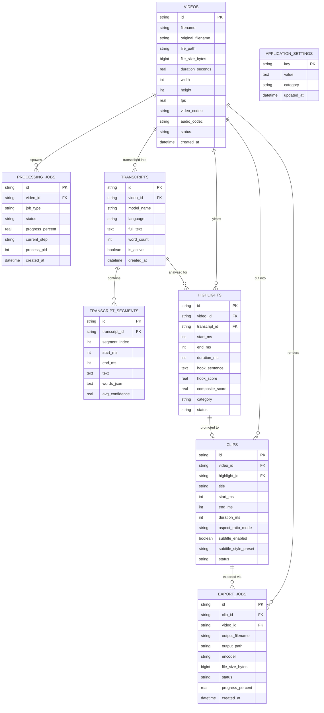
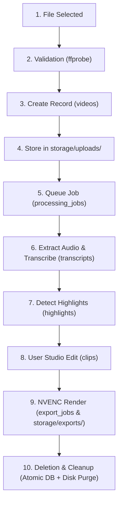

# Database Schema & Local Storage Engine

**Project Name:** AI Video Clipper (Working Title: Clipsly)  
**Document Version:** 1.0.0  
**Status:** APPROVED & FINALIZED (Phase 03 Specification Baseline)  
**Author:** Senior Database Architect & Backend Data Engineer  
**Database Engine:** SQLite 3 (WAL Mode) via SQLAlchemy 2.0 Async & aiosqlite  
**Target Host:** Local SSD (Windows 11 / Localhost)  

---

## 1. Executive Summary & Technology Stack

The Clipsly data architecture provides a zero-administration, durable, and ACID-compliant persistence layer operating entirely on the user's local SSD. 

The storage architecture is divided into two synchronized tiers:
1. **Relational Database Tier (`data/clipsly.db`):** Embedded SQLite 3 database managed via SQLAlchemy 2.0 Async, `aiosqlite`, and Alembic. It tracks technical video metadata, multi-step pipeline jobs, word-level speech transcripts, AI highlight scores, user clip customizations, and export rendering histories.
2. **Binary Media Storage Tier (`storage/`):** A strictly structured local directory hierarchy on the NVMe SSD that isolates raw uploads, 16kHz mono audio tracks, JSON transcript backups, intermediate video slices, ASS subtitle scripts, and production-ready 1080x1920 MP4 exports.

### Confirmed Database Stack & Justification

| Technology | Role | Justification |
|---|---|---|
| **SQLite 3** | Embedded Relational Engine | Zero server installation, zero network latency, file-based portability, ACID compliant, and exceptional performance on NVMe SSDs. |
| **Write-Ahead Logging (WAL)** | SQLite Concurrency Mode | Eliminates read-write contention; the React frontend can read videos and transcripts while the background worker writes progress without locking. |
| **SQLAlchemy 2.0 Async** | Relational ORM & Engine | Native `asyncio` support with `aiosqlite`, strong typing, strict declarative models, and clean session lifecycle management. |
| **Pydantic v2** | Schema Validation & Serialization | High-performance Rust-backed data validation for all API inputs, JSON serialization, and configuration parsing. |
| **Alembic** | Migration Management | Programmatic schema migrations (`alembic upgrade head`) ensuring seamless upgrades as features evolve without manual DDL scripts. |

---

## 2. Complete Database Schema Reference (8 Entities)

The schema defines eight relational entities. All primary keys utilize canonical **UUIDv4 strings (36-character `VARCHAR(36)`)** to prevent sequential enumeration, enable client-side UUID pre-allocation, and eliminate collision risks.

```
┌─────────────────────────────────────────────────────────────┐
│                      Entity Summary                         │
├──────────────────────────┬──────────────────────────────────┤
│ Table Name               │ Purpose                          │
├──────────────────────────┼──────────────────────────────────┤
│ `videos`                 │ Master ingested video files      │
│ `processing_jobs`        │ Pipeline task queue state        │
│ `transcripts`            │ Transcription run headers        │
│ `transcript_segments`    │ Word-level timestamp utterances  │
│ `highlights`             │ Algorithmic highlight candidates │
│ `clips`                  │ User-configured 9:16 short clips │
│ `export_jobs`            │ Final NVENC render jobs          │
│ `application_settings`   │ Key-value user configuration     │
└──────────────────────────┴──────────────────────────────────┘
```

---

### 2.1 Entity: `videos`
Stores metadata and technical stream characteristics for uploaded long-form source videos. Updated in Phase 13 to support rich stream metadata, orientation classification, rotation, bit depth, pixel formats, and optional audio streams.

```sql
CREATE TABLE videos (
    id VARCHAR(36) PRIMARY KEY,                         -- UUIDv4
    filename VARCHAR(255) NOT NULL,                     -- Sanitized storage filename (e.g., "a1b2_podcast.mp4")
    original_filename VARCHAR(255) NOT NULL,            -- Original file name as selected by user
    file_path VARCHAR(512) NOT NULL UNIQUE,             -- Relative or absolute path in storage directory
    file_size_bytes BIGINT NOT NULL,                    -- File size on disk in bytes
    duration_seconds REAL NOT NULL,                     -- Total duration in seconds (from ffprobe)
    width INTEGER NOT NULL,                             -- Video frame width (e.g., 1920)
    height INTEGER NOT NULL,                            -- Video frame height (e.g., 1080)
    aspect_ratio VARCHAR(16) NOT NULL,                  -- Display aspect ratio (e.g., "16:9")
    fps REAL NOT NULL,                                  -- Frames per second (e.g., 29.97, 30.0, 60.0)
    video_codec VARCHAR(32) NOT NULL,                   -- Codec identifier (e.g., "h264", "hevc", "vp9")
    audio_codec VARCHAR(32),                            -- Audio codec (nullable: NULL when video has no audio)
    audio_sample_rate INTEGER,                          -- Audio sample rate (nullable)
    audio_channels INTEGER,                             -- Channel count (nullable: 1 for mono, 2 for stereo)
    status VARCHAR(32) NOT NULL DEFAULT 'UPLOADED',     -- 'UPLOADED', 'PROBED', 'PROCESSING', 'READY', 'ERROR'
    error_message TEXT,                                 -- Technical error details if status='ERROR'
    container_format VARCHAR(64),                       -- Container format (e.g., 'mov,mp4,m4a,3gp,3g2,mj2', 'matroska,webm')
    bitrate BIGINT,                                     -- Overall container bitrate in bits per second
    video_codec_profile VARCHAR(64),                    -- Video codec profile (e.g., 'High', 'Main', 'Baseline')
    pixel_format VARCHAR(32),                           -- Pixel format (e.g., 'yuv420p', 'yuv422p10le')
    bit_depth INTEGER,                                  -- Color bit depth (e.g., 8, 10, 12)
    video_bitrate BIGINT,                               -- Video stream bitrate in bps
    rotation INTEGER NOT NULL DEFAULT 0,                -- Display rotation angle (0, 90, 180, 270)
    channel_layout VARCHAR(32),                         -- Audio channel layout (e.g., 'stereo', 'mono', '5.1')
    audio_bitrate BIGINT,                               -- Audio stream bitrate in bps
    orientation VARCHAR(16) NOT NULL DEFAULT 'landscape', -- 'landscape', 'portrait', 'square'
    metadata_status VARCHAR(32) NOT NULL DEFAULT 'COMPLETED', -- 'PENDING', 'PROCESSING', 'COMPLETED', 'FAILED'
    metadata_extracted_at DATETIME,                     -- UTC timestamp when FFprobe extracted stream metadata
    metadata_json TEXT,                                 -- Raw FFprobe JSON extraction payload for auditing
    created_at DATETIME NOT NULL DEFAULT CURRENT_TIMESTAMP,
    updated_at DATETIME NOT NULL DEFAULT CURRENT_TIMESTAMP,
    
    CONSTRAINT chk_video_size CHECK (file_size_bytes > 0),
    CONSTRAINT chk_video_duration CHECK (duration_seconds > 0.0),
    CONSTRAINT chk_video_dimensions CHECK (width > 0 AND height > 0)
);

CREATE INDEX idx_videos_status ON videos(status);
CREATE INDEX idx_videos_created_at ON videos(created_at DESC);
CREATE INDEX idx_videos_metadata_status ON videos(metadata_status);
```

---

### 2.2 Entity: `processing_jobs`
Tracks execution state, percentage progress, and errors for multi-step background pipeline jobs (ADR-001).

```sql
CREATE TABLE processing_jobs (
    id VARCHAR(36) PRIMARY KEY,                         -- UUIDv4
    video_id VARCHAR(36) NOT NULL,                      -- Foreign Key to videos.id
    job_type VARCHAR(32) NOT NULL,                      -- 'AUDIO_EXTRACTION', 'TRANSCRIPTION', 'HIGHLIGHT_DETECTION', 'FULL_PIPELINE'
    status VARCHAR(32) NOT NULL DEFAULT 'QUEUED',       -- 'QUEUED', 'PROCESSING', 'COMPLETED', 'FAILED', 'CANCELLED', 'INTERRUPTED'
    progress_percent REAL NOT NULL DEFAULT 0.0,         -- 0.0 to 100.0
    current_step VARCHAR(64) NOT NULL DEFAULT 'Queued', -- User-facing status string
    error_message TEXT,                                 -- Traceback or error details on failure
    process_pid INTEGER,                                -- Subprocess PID for active FFmpeg/Whisper job
    started_at DATETIME,                                -- Timestamp when worker began execution
    completed_at DATETIME,                              -- Timestamp when job reached terminal state
    created_at DATETIME NOT NULL DEFAULT CURRENT_TIMESTAMP,
    updated_at DATETIME NOT NULL DEFAULT CURRENT_TIMESTAMP,

    FOREIGN KEY (video_id) REFERENCES videos(id) ON DELETE CASCADE,
    CONSTRAINT chk_job_progress CHECK (progress_percent >= 0.0 AND progress_percent <= 100.0)
);

CREATE INDEX idx_jobs_video_id ON processing_jobs(video_id);
CREATE INDEX idx_jobs_status ON processing_jobs(status);
CREATE INDEX idx_jobs_created_at ON processing_jobs(created_at ASC);
```

---

### 2.3 Entity: `transcripts`
Header record for a speech-to-text transcription run. Supports versioning if the user re-transcribes with a different model size or language.

```sql
CREATE TABLE transcripts (
    id VARCHAR(36) PRIMARY KEY,                         -- UUIDv4
    video_id VARCHAR(36) NOT NULL,                      -- Foreign Key to videos.id
    model_name VARCHAR(32) NOT NULL,                    -- "tiny", "base", "small", "medium"
    compute_type VARCHAR(32) NOT NULL,                  -- "float16", "int8_float16", "int8"
    language VARCHAR(16) NOT NULL DEFAULT 'en',         -- Detected or specified BCP-47 language code
    full_text TEXT NOT NULL,                            -- Full concatenated plain-text transcript body
    word_count INTEGER NOT NULL DEFAULT 0,              -- Total words recognized
    processing_time_seconds REAL NOT NULL DEFAULT 0.0,  -- Time taken by Faster-Whisper inference
    is_active BOOLEAN NOT NULL DEFAULT 1,               -- Flag identifying currently active version
    created_at DATETIME NOT NULL DEFAULT CURRENT_TIMESTAMP,
    updated_at DATETIME NOT NULL DEFAULT CURRENT_TIMESTAMP,

    FOREIGN KEY (video_id) REFERENCES videos(id) ON DELETE CASCADE,
    CONSTRAINT chk_word_count CHECK (word_count >= 0)
);

CREATE INDEX idx_transcripts_video_id ON transcripts(video_id);
CREATE INDEX idx_transcripts_is_active ON transcripts(video_id, is_active);
```

---

### 2.4 Entity: `transcript_segments`
Stores individual sentence-level utterances with complete word-level timestamp JSON arrays for karaoke synchronization.

```sql
CREATE TABLE transcript_segments (
    id VARCHAR(36) PRIMARY KEY,                         -- UUIDv4
    transcript_id VARCHAR(36) NOT NULL,                 -- Foreign Key to transcripts.id
    segment_index INTEGER NOT NULL,                     -- 0-indexed sequential order
    start_ms INTEGER NOT NULL,                          -- Segment start in milliseconds
    end_ms INTEGER NOT NULL,                            -- Segment end in milliseconds
    text TEXT NOT NULL,                                 -- Sentence text body
    words_json TEXT NOT NULL,                           -- JSON array: [{"word":"Hello","start_ms":0,"end_ms":420,"prob":0.98}]
    avg_confidence REAL NOT NULL DEFAULT 1.0,           -- Average token probability (0.0 to 1.0)
    speaker_id VARCHAR(32),                             -- Optional speaker tag (e.g., "SPEAKER_00")
    created_at DATETIME NOT NULL DEFAULT CURRENT_TIMESTAMP,
    updated_at DATETIME NOT NULL DEFAULT CURRENT_TIMESTAMP,

    FOREIGN KEY (transcript_id) REFERENCES transcripts(id) ON DELETE CASCADE,
    CONSTRAINT chk_segment_timing CHECK (start_ms >= 0 AND end_ms > start_ms),
    CONSTRAINT chk_segment_index CHECK (segment_index >= 0)
);

CREATE INDEX idx_segments_transcript_id ON transcript_segments(transcript_id);
CREATE INDEX idx_segments_timing ON transcript_segments(transcript_id, start_ms, end_ms);
```

---

### 2.5 Entity: `highlights`
Stores algorithmically scored candidate segments detected across the transcript (ADR-003).

```sql
CREATE TABLE highlights (
    id VARCHAR(36) PRIMARY KEY,                         -- UUIDv4
    video_id VARCHAR(36) NOT NULL,                      -- Foreign Key to videos.id
    transcript_id VARCHAR(36) NOT NULL,                 -- Foreign Key to transcripts.id
    start_ms INTEGER NOT NULL,                          -- Highlight start timestamp in milliseconds
    end_ms INTEGER NOT NULL,                            -- Highlight end timestamp in milliseconds
    duration_ms INTEGER NOT NULL,                       -- end_ms - start_ms
    hook_sentence TEXT NOT NULL,                        -- Opening sentence acting as narrative hook
    summary TEXT,                                       -- Short topical summary of the segment
    hook_score REAL NOT NULL,                           -- 0.0 to 100.0 (Hook punchiness)
    coherence_score REAL NOT NULL,                      -- 0.0 to 100.0 (Sentence completeness)
    density_score REAL NOT NULL,                        -- 0.0 to 100.0 (Words per minute pacing)
    sentiment_score REAL NOT NULL,                      -- 0.0 to 100.0 (Vocal energy / valence)
    composite_score REAL NOT NULL,                      -- 0.0 to 100.0 (Weighted total score)
    category VARCHAR(32) NOT NULL DEFAULT 'Insight',    -- 'Insight', 'Story', 'Punchline', 'Discussion'
    detection_method VARCHAR(32) NOT NULL DEFAULT 'HEURISTIC', -- 'HEURISTIC', 'HYBRID_API'
    status VARCHAR(32) NOT NULL DEFAULT 'CANDIDATE',    -- 'CANDIDATE', 'ACCEPTED', 'DISCARDED'
    created_at DATETIME NOT NULL DEFAULT CURRENT_TIMESTAMP,
    updated_at DATETIME NOT NULL DEFAULT CURRENT_TIMESTAMP,

    FOREIGN KEY (video_id) REFERENCES videos(id) ON DELETE CASCADE,
    FOREIGN KEY (transcript_id) REFERENCES transcripts(id) ON DELETE CASCADE,
    CONSTRAINT chk_highlight_timing CHECK (start_ms >= 0 AND end_ms > start_ms),
    CONSTRAINT chk_composite_score CHECK (composite_score >= 0.0 AND composite_score <= 100.0)
);

CREATE INDEX idx_highlights_video_score ON highlights(video_id, composite_score DESC);
CREATE INDEX idx_highlights_status ON highlights(video_id, status);
```

---

### 2.6 Entity: `clips`
Stores user-customized short-form clips. Represents the active configuration in the Interactive Clip Studio.

```sql
CREATE TABLE clips (
    id VARCHAR(36) PRIMARY KEY,                         -- UUIDv4
    video_id VARCHAR(36) NOT NULL,                      -- Foreign Key to videos.id
    highlight_id VARCHAR(36),                           -- Optional FK to highlights.id (SET NULL on delete)
    title VARCHAR(255) NOT NULL DEFAULT 'Untitled Clip',-- User-editable clip title
    start_ms INTEGER NOT NULL,                          -- User-trimmed start boundary (ms)
    end_ms INTEGER NOT NULL,                            -- User-trimmed end boundary (ms)
    duration_ms INTEGER NOT NULL,                       -- Trimmed duration (ms)
    aspect_ratio_mode VARCHAR(32) NOT NULL DEFAULT 'BLUR_PAD', -- 'BLUR_PAD', 'CENTER_CROP'
    subtitle_enabled BOOLEAN NOT NULL DEFAULT 1,        -- Whether burned subtitles are active
    subtitle_style_preset VARCHAR(64) NOT NULL DEFAULT 'KARAOKE_AMBER',
    subtitle_font_family VARCHAR(64) NOT NULL DEFAULT 'Montserrat',
    subtitle_font_size INTEGER NOT NULL DEFAULT 24,     -- Font size in points
    subtitle_primary_color VARCHAR(16) NOT NULL DEFAULT '#FFFFFF',
    subtitle_highlight_color VARCHAR(16) NOT NULL DEFAULT '#FFD700',
    subtitle_outline_color VARCHAR(16) NOT NULL DEFAULT '#000000',
    subtitle_outline_width INTEGER NOT NULL DEFAULT 3,  -- Stroke thickness in pixels
    subtitle_vertical_position VARCHAR(16) NOT NULL DEFAULT 'BOTTOM', -- 'BOTTOM', 'MIDDLE', 'TOP'
    custom_subtitle_text TEXT,                          -- Optional overridden transcript text
    status VARCHAR(32) NOT NULL DEFAULT 'DRAFT',        -- 'DRAFT', 'READY', 'EXPORTING', 'EXPORTED'
    created_at DATETIME NOT NULL DEFAULT CURRENT_TIMESTAMP,
    updated_at DATETIME NOT NULL DEFAULT CURRENT_TIMESTAMP,

    FOREIGN KEY (video_id) REFERENCES videos(id) ON DELETE CASCADE,
    FOREIGN KEY (highlight_id) REFERENCES highlights(id) ON DELETE SET NULL,
    CONSTRAINT chk_clip_timing CHECK (start_ms >= 0 AND end_ms > start_ms),
    CONSTRAINT chk_clip_duration CHECK (duration_ms >= 5000) -- Minimum 5 seconds
);

CREATE INDEX idx_clips_video_id ON clips(video_id);
CREATE INDEX idx_clips_status ON clips(status);
```

---

### 2.7 Entity: `export_jobs`
Tracks final MP4 rendering jobs executed via NVIDIA NVENC hardware acceleration.

```sql
CREATE TABLE export_jobs (
    id VARCHAR(36) PRIMARY KEY,                         -- UUIDv4
    clip_id VARCHAR(36) NOT NULL,                       -- Foreign Key to clips.id
    video_id VARCHAR(36) NOT NULL,                      -- Foreign Key to videos.id
    output_filename VARCHAR(255) NOT NULL,              -- Final filename: "{title}_clip_{index}.mp4"
    output_path VARCHAR(512) NOT NULL,                  -- Relative path: "storage/exports/{id}.mp4"
    resolution VARCHAR(16) NOT NULL DEFAULT '1080x1920',-- Final export canvas
    fps REAL NOT NULL DEFAULT 30.0,                     -- Export frame rate
    encoder VARCHAR(32) NOT NULL DEFAULT 'h264_nvenc',  -- 'h264_nvenc' or 'libx264'
    render_time_seconds REAL,                           -- Time elapsed during NVENC render
    file_size_bytes BIGINT,                             -- Output file size in bytes
    status VARCHAR(32) NOT NULL DEFAULT 'QUEUED',       -- 'QUEUED', 'RENDERING', 'COMPLETED', 'FAILED', 'CANCELLED'
    progress_percent REAL NOT NULL DEFAULT 0.0,         -- 0.0 to 100.0
    error_message TEXT,                                 -- Render error log on failure
    process_pid INTEGER,                                -- Subprocess PID of FFmpeg export
    started_at DATETIME,                                -- Render start time
    completed_at DATETIME,                              -- Render finish time
    created_at DATETIME NOT NULL DEFAULT CURRENT_TIMESTAMP,

    FOREIGN KEY (clip_id) REFERENCES clips(id) ON DELETE CASCADE,
    FOREIGN KEY (video_id) REFERENCES videos(id) ON DELETE CASCADE,
    CONSTRAINT chk_export_progress CHECK (progress_percent >= 0.0 AND progress_percent <= 100.0)
);

CREATE INDEX idx_exports_clip_id ON export_jobs(clip_id);
CREATE INDEX idx_exports_video_id ON export_jobs(video_id);
CREATE INDEX idx_exports_status ON export_jobs(status);
```

---

### 2.8 Entity: `application_settings`
Key-value configuration store for hardware settings, default styling presets, and user preferences.

```sql
CREATE TABLE application_settings (
    key VARCHAR(64) PRIMARY KEY,                        -- Unique setting key (e.g., "transcription.model")
    value TEXT NOT NULL,                                -- JSON-encoded or scalar string value
    category VARCHAR(32) NOT NULL DEFAULT 'GENERAL',    -- 'GENERAL', 'AI', 'EXPORT', 'STORAGE'
    description TEXT,                                   -- Explanation of setting purpose
    updated_at DATETIME NOT NULL DEFAULT CURRENT_TIMESTAMP
);
```

#### Seed Defaults for `application_settings`:
- `'transcription.default_model'`: `"small"`
- `'transcription.compute_type'`: `"float16"`
- `'highlight.min_duration_s'`: `"30"`
- `'highlight.max_duration_s'`: `"60"`
- `'highlight.external_api_key'`: `""`
- `'export.default_encoder'`: `"h264_nvenc"`
- `'export.nvenc_preset'`: `"p4"`
- `'storage.min_free_space_gb'`: `"10"`
- `'storage.retain_intermediate_clips'`: `"false"`

---

## 3. Database Entity-Relationship (ER) Diagram



---

## 4. Deletion Policies & Cascading Cleanup

### 4.1 Relational Cascades vs. File System Deletion

| Parent Action | Affected Children | Database Cascade Rule | File System Action |
|---|---|---|---|
| **Delete Video** | `processing_jobs` | `ON DELETE CASCADE` | Child job records removed from SQLite |
| **Delete Video** | `transcripts` | `ON DELETE CASCADE` | Associated JSON files in `storage/transcripts/` unlinked |
| **Delete Video** | `transcript_segments` | `ON DELETE CASCADE` | Segment rows removed from SQLite |
| **Delete Video** | `highlights` | `ON DELETE CASCADE` | Highlight scores removed from SQLite |
| **Delete Video** | `clips` | `ON DELETE CASCADE` | Intermediate video slices in `storage/clips/` unlinked |
| **Delete Video** | Source Video File | N/A (Application logic)| `storage/uploads/{id}.mp4` and `storage/audio/{id}_16k.wav` unlinked |
| **Delete Video** | `export_jobs` & Exports | `ON DELETE CASCADE` | **NEVER DELETE EXPORT FILES AUTOMATICALLY.** Database records cascade, but finished MP4s in `storage/exports/` are preserved on disk unless user explicitly checks *"Also delete exported videos"*. |
| **Delete Highlight** | `clips` | `ON DELETE SET NULL` | Clip configuration remains intact; `highlight_id` becomes `NULL` |
| **Delete Clip** | `export_jobs` | `ON DELETE CASCADE` | Intermediate clip file deleted; final exported MP4 preserved |

---

## 5. Local Storage Architecture

The application enforces a strictly partitioned directory hierarchy on the local NVMe SSD:

```
clipsly/
├── data/
│   ├── clipsly.db            # Primary SQLite database file
│   ├── clipsly.db-wal        # Write-Ahead Log
│   ├── clipsly.db-shm        # Shared memory index
│   └── backups/              # Automated database snapshots
│       └── clipsly_backup_{date}.db
├── logs/
│   ├── clipsly_app.log       # Application execution and error logs
│   └── clipsly_ffmpeg.log    # Detailed FFmpeg filtergraph logs
└── storage/
    ├── uploads/              # Ingested raw video files ({video_id}.mp4)
    ├── audio/                # Normalized 16kHz mono WAV files ({video_id}_16k.wav)
    ├── transcripts/          # Backup JSON dumps of Faster-Whisper tokens
    ├── clips/                # Intermediate sliced sub-clips ({clip_id}_cut.mp4)
    ├── subtitles/            # Formatted ASS subtitle scripts ({clip_id}.ass)
    ├── exports/              # Production-ready 1080x1920 MP4 video files
    └── temp/                 # Scratch space for FFmpeg intermediate filter passes
```

### Storage Security & Path Traversal Mitigations
- **Relative Resolution:** All paths stored in the database are stored as **relative paths** (e.g., `storage/uploads/a1b2.mp4`), never absolute Windows drive paths (`C:\...`).
- **Path Confinement Check:** When opening files, the backend resolves the path using Python `pathlib.Path` and explicitly verifies confinement:
  ```python
  resolved_path = (BASE_STORAGE_DIR / relative_path).resolve()
  if not resolved_path.is_relative_to(BASE_STORAGE_DIR.resolve()):
      raise SecurityException("Path traversal attempt detected.")
  ```
- **UUID Filename Mapping:** Uploaded files are immediately renamed on disk to `{uuid4}.{ext}`. The original filename (e.g., `My Podcast Episode 12.mp4`) is preserved safely as metadata in `videos.original_filename`.

---

## 6. Video & File Lifecycle (10 Deterministic Stages)



### Detailed Lifecycle Handling:

1. **User Selects Video:** File selected via drag-and-drop or native OS file picker.
2. **Validation:** FastAPI streams the first 64KB to verify container magic bytes; `ffprobe` validates container integrity, duration, and confirms presence of both video and audio streams.
3. **Database Record Created:** Initial row inserted into `videos` with `status='UPLOADED'`.
4. **Original Video Stored:** Streamed directly to `storage/uploads/{id}.mp4` using 1MB chunked buffers to avoid RAM consumption.
5. **Processing Job Enqueued:** Background worker enqueues a `FULL_PIPELINE` job in `processing_jobs` table.
6. **Audio & Transcription Stored:** Audio is extracted to `storage/audio/{id}_16k.wav`. Faster-Whisper populates `transcripts` and `transcript_segments`. A JSON backup is written to `storage/transcripts/{id}.json`.
7. **Highlights Detected:** Highlights are algorithmically scored and inserted into `highlights`.
8. **Clips Configured:** When the user promotes a highlight or customizes trim handles in the Studio, a `clips` row is created.
9. **Exports Recorded:** User clicks "Export". FFmpeg renders the 1080x1920 MP4 to `storage/exports/{id}.mp4` and records the output in `export_jobs`.
10. **Deletion & Cleanup:** When a project is deleted, SQLite handles relational cleanup; the backend unlinks intermediate files while preserving final exported MP4s.

### Handling Storage Anomalies:
- **Missing Files:** If an underlying media file was moved or deleted by the user externally on Windows, the application catches `FileNotFoundError`, marks the database record as `status='FILE_MISSING'`, and displays a warning badge in the UI rather than crashing.
- **Orphaned Files:** The system provides an automated "Scan for Orphaned Files" maintenance routine in Settings. It compares files on the SSD against valid database records; any unreferenced files in `storage/temp/` or `storage/uploads/` can be deleted with a single click.
- **Interrupted Jobs:** On startup, the `lifespan` hook queries `processing_jobs` for any records with `status='PROCESSING'`. These are transitioned to `INTERRUPTED`, and partial scratch files in `storage/temp/` are immediately purged.

---

## 7. Storage Management & Capacity Safeguards

### 7.1 Automated Disk Space Checks
Before accepting any file upload or launching an NVENC render session, the backend calls `shutil.disk_usage(STORAGE_DIR)`:
- **Free Space $> 15\text{ GB}$:** Normal operation.
- **Free Space between $10\text{ GB}$ and $15\text{ GB}$:** System displays an informational UI warning banner: *"Local SSD storage running low (<15 GB remaining)."*
- **Free Space $< 10\text{ GB}$:** **Hard Block.** The API rejects new uploads and blocks export rendering with HTTP 507 Insufficient Storage: *"Operation halted: Less than 10 GB free space on local SSD."*

### 7.2 Scratch & Intermediate File Cleanup Policy
- **`storage/temp/`:** Automatically emptied upon task completion (success or failure) via a Python `try...finally` cleanup block.
- **`storage/clips/`:** Intermediate cuts are unlinked immediately after final subtitle burn-in completes, unless the user explicitly toggles `'storage.retain_intermediate_clips'` to `true` in Settings.
- **`storage/exports/`:** User-created final MP4s are **never automatically purged**.

---

## 8. Database Performance, Concurrency & Reliability

### 8.1 SQLite Write-Ahead Logging (WAL) Configuration
On application startup, the SQLAlchemy asynchronous engine configures connection PRAGMAs:
```python
@event.listens_for(engine.sync_engine, "connect")
def set_sqlite_pragma(dbapi_connection, connection_record):
    cursor = dbapi_connection.cursor()
    cursor.execute("PRAGMA journal_mode=WAL;")
    cursor.execute("PRAGMA synchronous=NORMAL;")
    cursor.execute("PRAGMA busy_timeout=30000;")       # 30-second lock timeout
    cursor.execute("PRAGMA foreign_keys=ON;")          # Enforce foreign key constraints
    cursor.execute("PRAGMA cache_size=-64000;")        # 64MB memory page cache
    cursor.close()
```

### 8.2 Why Database Locking is Eliminated
1. **WAL Concurrency:** SQLite WAL mode permits unlimited concurrent readers while a writer transaction is active. The React UI can poll videos, fetch transcripts, and inspect highlights without blocking the background worker.
2. **Single-Writer Worker Loop (ADR-001):** Because background pipeline tasks are processed sequentially via the in-process `asyncio.Queue`, simultaneous background write collisions are completely avoided.
3. **Short-Lived Transactions:** Database transactions are committed immediately following discrete state changes (e.g., updating progress percentage), holding write locks for $< 5\text{ms}$.

### 8.3 Migration Strategy with Alembic
Database schema evolution is managed through Alembic:
- Migrations reside in `backend/alembic/versions/`.
- Alembic is configured to run in async mode via `async_engine`.
- The application automatically executes `alembic upgrade head` during the FastAPI `lifespan` startup hook, ensuring smooth schema transitions on updates.

### 8.4 Hot Backup Strategy
The backend implements an automated, non-blocking backup utility leveraging the SQLite Online Backup API (`sqlite3_backup`):
- Executes weekly or on user demand via `POST /api/v1/system/backup`.
- Copies active pages safely to `data/backups/clipsly_backup_{date}.db` without locking read or write traffic.

---

## 9. Data Validation & Security Rules

1. **Pydantic v2 Schema Enforcement:** Every API request payload is strictly validated before reaching the database layer.
2. **Allowed Container Extensions:** Whitelist restricted to `.mp4`, `.mkv`, `.mov`, `.webm`.
3. **Timestamp Integrity Constraints:** Database CHECK constraints guarantee `start_ms >= 0` and `end_ms > start_ms`.
4. **Score Bounds:** Highlight and job progress fields are clamped strictly to $[0.0, 100.0]$.

---

## 10. Architecture Decision Records for Database Tier

### ADR-007: SQLite 3 WAL Mode with SQLAlchemy 2.0 Async
- **Context:** Need an embedded, zero-admin database engine supporting asynchronous FastAPI operations without locking conflicts.
- **Options Considered:** (A) Raw SQLite3 / aiosqlite, (B) DuckDB, (C) SQLite 3 WAL with SQLAlchemy 2.0 Async.
- **Selected Decision:** **Option C.**
- **Reason:** SQLite 3 in WAL mode provides standard ACID compliance, zero setup, and rock-solid reliability on Windows NVMe SSDs. SQLAlchemy 2.0 provides mature async session management and Alembic integration.
- **Status:** **APPROVED.**

### ADR-008: Preservation of User Exports on Parent Deletion
- **Context:** Deleting a source video could inadvertently delete hours of rendered short clips.
- **Options Considered:** (A) Hard delete all files including exports, (B) Preserve exports on disk while deleting database parent records.
- **Selected Decision:** **Option B.**
- **Reason:** Protects user content. Rendered MP4s represent finished creative output and must never be deleted without explicit, separate user confirmation.
- **Status:** **APPROVED.**

---

## 11. Current Status & Next Steps

- **Status:** **PHASE 12 COMPLETED & VERIFIED.**
- **Implementation Highlights:**
  - Complete declarative ORM definitions for all 8 entities in `backend/app/models/`.
  - Full relationship mapping with cascading deletion rules on parent models (`Video`, `Clip`).
  - SQLite WAL mode and foreign key constraints enforced on every connection checkout.
  - Phase 11 Project Management System: cascade deletion and safe SSD media purge flags.
  - Phase 12 Local Video Upload & Ingestion Pipeline:
    - Bounded streaming ingestion (1MB chunk buffers) into temporary scratch storage (`storage/temp/upload_{uuid}.tmp`).
    - FFprobe container and stream validation (verifying video codec, audio codec, dimensions, framerate, duration bounds).
    - Atomic file relocation: temporary scratch file moved to final destination (`storage/uploads/{video_id}.{ext}`) with strict path containment checks.
    - Database registration: `Video` record inserted with `status='READY'`, original filename preserved, and technical metadata populated.
    - Zero orphaned files: automated cleanup unlinks temporary scratch files upon failure, cancellation, or database rollback.
    - Duplicate upload policy: uploads with matching original filenames receive distinct UUID storage filenames and independent database records.
  - 42 backend pytest tests passing (100%) and 73 frontend Vitest tests passing (100%).
- **Immediate Next Step:** Proceed to **Phase 13 (Audio Extraction & Media Metadata Pipeline)** upon user approval.
