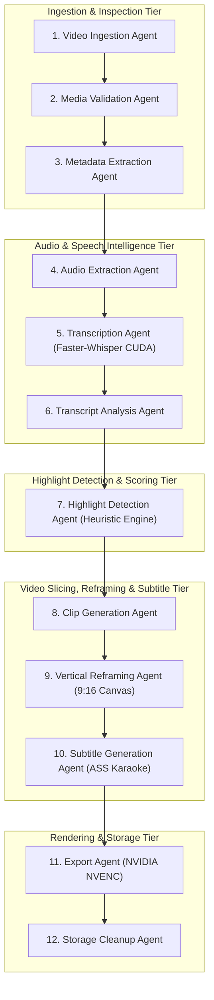

# AI Agent Architecture & Media Processing Workflow

**Project Name:** AI Video Clipper (Working Title: Clipsly)  
**Document Version:** 1.0.0  
**Status:** APPROVED & FINALIZED (Phase 05 Baseline)  
**Author:** Lead AI Systems Architect & Media Pipeline Engineer  
**Target Hardware:** ASUS TUF A15 (AMD Ryzen 7 7000 Series, NVIDIA RTX 3050 Laptop GPU with 4GB VRAM, 16GB DDR5 RAM, NVMe SSD)  

---

## 1. Executive Summary & Architectural Scope

This document establishes the architecture, boundaries, contracts, and failure-recovery protocols for the **twelve logical processing modules (termed "Agents")** that drive the Clipsly multimedia pipeline.

In Clipsly, an **Agent** refers to a dedicated, modular, and testable processing service within the backend system. With the exception of the optional cloud-augmented highlight analyzer, these modules operate as deterministic, local-first Python/C++ compute units (leveraging FFmpeg, FFprobe, and Faster-Whisper CTranslate2) that execute **strictly sequentially** within an in-process, SQLite-backed asynchronous queue (ADR-001, ADR-002).



---

## 2. Detailed Specifications for the 12 Processing Modules (Agents)

---

### Module 1: Video Ingestion Agent
- **Purpose:** Ingests local horizontal video files into the application's local SSD storage.
- **Input:** Multipart/form-data chunked binary upload stream (`POST /api/v1/videos/upload`).
- **Output:** Stored raw media file at `storage/uploads/{video_id}.{ext}`.
- **Responsibilities:**
  - Stream binary chunks directly to disk in 1MB buffer increments to protect host RAM.
  - Generate a secure UUIDv4 identifier for the video (`{video_id}`).
  - Sanitize the original user filename against path traversal characters (`..`, `/`, `\`).
  - Verify disk space capacity ($\ge 10\text{ GB}$) before committing file write.
- **Dependencies:** Local SSD storage subsystem (`storage/uploads/`).
- **Failure Conditions:** Client network drop, disk write permission failure, storage $< 10\text{ GB}$.
- **Retry Behaviour:** Client must re-initiate upload; partial file is immediately unlinked.
- **Logging Requirements:** Log upload start, duration, byte count, and sanitized filename at `INFO` level.
- **Database Interactions:** Inserts initial record into `videos` table (`status='UPLOADED'`).
- **API Interactions:** Handled by `POST /api/v1/videos/upload`.

---

### Module 2: Media Validation Agent
- **Purpose:** Performs container integrity checks and verifies audio/video stream presence.
- **Input:** Path to uploaded video in `storage/uploads/{video_id}.{ext}`.
- **Output:** Boolean validation status and preliminary container flags.
- **Responsibilities:**
  - Execute `ffprobe` in non-blocking subprocess with 10-second timeout.
  - Verify container is a valid `.mp4`, `.mkv`, `.mov`, or `.webm`.
  - Confirm presence of at least one valid video stream and one valid audio stream.
  - Reject silent videos immediately with descriptive error code (`INVALID_FILE_FORMAT`).
- **Dependencies:** Subprocess execution manager (`SafeSubprocessRunner`), `ffprobe` binary.
- **Failure Conditions:** Truncated container, unreadable moov atom, silent video (zero audio streams).
- **Retry Behaviour:** Non-retryable; user must upload a valid file with audio.
- **Logging Requirements:** Log `ffprobe` exit code and stream signatures.
- **Database Interactions:** Updates `videos.status` to `'PROBING'` or `'ERROR'`.
- **API Interactions:** Synchronous feedback during upload or early job validation.

---

### Module 3: Metadata Extraction Agent
- **Purpose:** Extracts technical stream metrics required for layout composition and database indexing.
- **Input:** Path to validated video file.
- **Output:** Structured JSON metadata dictionary.
- **Responsibilities:**
  - Parse container duration (seconds), video dimensions ($W \times H$), pixel aspect ratio, FPS, video codec, audio codec, audio sample rate (Hz), and audio channel count.
  - Calculate display aspect ratio (e.g., `16:9`, `4:3`).
- **Dependencies:** `ffprobe` binary.
- **Failure Conditions:** Corrupted stream headers, missing duration tag.
- **Retry Behaviour:** Fall back to secondary `ffmpeg -i` scan to calculate duration if `ffprobe` stream duration is `N/A`.
- **Logging Requirements:** Log parsed stream parameters at `DEBUG` level.
- **Database Interactions:** Updates `videos` table with duration, dimensions, FPS, codecs, and sets `status='READY'`.
- **API Interactions:** Data returned via `GET /api/v1/videos/{video_id}`.

---

### Module 4: Audio Extraction Agent
- **Purpose:** Demuxes and resamples the audio track into speech-recognition-optimized PCM WAV format.
- **Input:** Source video at `storage/uploads/{video_id}.{ext}`.
- **Output:** Extracted 16kHz Mono 16-bit PCM WAV at `storage/audio/{video_id}_16k.wav`.
- **Responsibilities:**
  - Invoke `ffmpeg -y -i {input} -vn -acodec pcm_s16le -ar 16000 -ac 1 {output}`.
  - Downmix multi-channel audio (stereo, 5.1) to single-channel mono.
  - Standardize sample rate strictly to 16,000 Hz for Faster-Whisper.
- **Dependencies:** `ffmpeg` binary with CPU execution.
- **Failure Conditions:** Unsupported source audio codec, disk write failure.
- **Retry Behaviour:** Retry once with software downmix filter (`-af "pan=mono|c0=0.5*c0+0.5*c1"`).
- **Logging Requirements:** Log audio duration and extraction duration.
- **Database Interactions:** Updates `processing_jobs.current_step = 'Extracting 16kHz audio'`.
- **API Interactions:** Emits SSE `job_progress` event with 10% progress.

---

### Module 5: Transcription Agent (Faster-Whisper CUDA)
- **Purpose:** Performs GPU-accelerated speech-to-text transcription with word-level timestamps.
- **Input:** 16kHz Mono WAV file at `storage/audio/{video_id}_16k.wav`.
- **Output:** List of sentence segments with word-level timestamps and token probabilities.
- **Responsibilities:**
  - Initialize `faster-whisper.WhisperModel` on CUDA (`device="cuda"`, `compute_type="float16"` or `"int8_float16"`).
  - Apply Silero VAD (Voice Activity Detection) pre-filter to skip silent audio sections.
  - Extract word-level start/end timestamps in milliseconds (`word.start`, `word.end`, `word.probability`).
  - **Memory Evacuation (ADR-002):** Explicitly delete model instance (`del model`) and trigger garbage collection (`gc.collect()`) upon completion to return VRAM to 0MB before next pipeline stages.
- **Dependencies:** CTranslate2, NVIDIA CUDA Toolkit 12.x, cuDNN 8/9 DLLs, RTX 3050 GPU.
- **Failure Conditions:** CUDA Out-Of-Memory (OOM), missing CUDA DLLs.
- **Retry Behaviour:** Catch `RuntimeError / OutOfMemoryError`, log warning, and automatically re-run on CPU using AMD Ryzen 7 7000 CPU (`device="cpu"`, `compute_type="int8"`, `threads=8`).
- **Logging Requirements:** Log RTF (Real-Time Factor), word count, detected language, and peak VRAM.
- **Database Interactions:** Inserts record into `transcripts` and batch inserts all utterances into `transcript_segments`. Writes backup JSON to `storage/transcripts/{transcript_id}.json`.
- **API Interactions:** Emits SSE `job_progress` events (progress 20% to 70%).

---

### Module 6: Transcript Analysis Agent
- **Purpose:** Analyzes transcript tokens, reconstructs sentence structures, and identifies acoustic pause markers.
- **Input:** Array of `transcript_segments` records from SQLite.
- **Output:** Normalized discourse map containing sentence boundaries, word count, words-per-minute (WPM) density, and silence duration markers.
- **Responsibilities:**
  - Detect sentence terminations based on punctuation (`.`, `?`, `!`) and pauses $> 0.6\text{s}$.
  - Calculate speaking rate for each discourse segment.
  - Mark natural breathing gaps suitable for clip boundary snapping.
- **Dependencies:** Python pure standard library NLP / Regex.
- **Failure Conditions:** Empty transcript (video contained music or noise without speech).
- **Retry Behaviour:** Non-retryable; terminates pipeline with informative warning: *"No spoken dialogue detected"*.
- **Logging Requirements:** Log sentence count and average speaking cadence.
- **Database Interactions:** Reads `transcript_segments`; updates `processing_jobs.current_step = 'Analyzing discourse'`.
- **API Interactions:** Emits SSE `job_progress` event (75%).

---

### Module 7: Highlight Detection Agent (Heuristic Engine)
- **Purpose:** Identifies and ranks compelling short-form candidate segments within target duration bounds (ADR-003).
- **Input:** Normalized discourse map and user duration parameters ($T_{\min}=30\text{s}, T_{\max}=60\text{s}$).
- **Output:** Ranked array of candidate highlights with 4D composite scores ($0–100$) and opening hook snippets.
- **Responsibilities:**
  - Execute sliding window scan ($T \in [T_{\min}, T_{\max}]$ with $10\text{s}$ step).
  - Calculate Composite Score based on:
    - **Hook Punchiness (30%):** Evaluates opening 5 seconds against provocative lexical trigger patterns.
    - **Thematic Coherence (30%):** Measures grammatical completeness and absence of dangling thoughts.
    - **Information Density (25%):** Scores cadence adherence to the viral range ($130–175\text{ WPM}$).
    - **Vocal Sentiment Modulation (15%):** Estimates energy variation and exclamation markers.
  - Deduplicate overlapping candidate windows (Non-Maximum Suppression keeping highest score).
  - **Optional External AI Branch:** If user configured an API key in Settings, submit transcript text to Gemini/OpenAI Flash to re-rank top candidates.
- **Dependencies:** Heuristic scoring service; optional HTTP TLS client for external API.
- **Failure Conditions:** Zero candidates meeting minimum score threshold ($> 50.0$).
- **Retry Behaviour:** Automatically widen sliding window bounds by $\pm 10\text{s}$ and re-scan.
- **Logging Requirements:** Log candidate count, score distribution, and detection duration ($< 2\text{s}$).
- **Database Interactions:** Inserts top candidates into `highlights` table.
- **API Interactions:** Emits SSE `job_completed` with candidate highlight count. Highlights available via `GET /api/v1/videos/{video_id}/highlights`.

---

### Module 8: Clip Generation Agent
- **Purpose:** Extracts sample-accurate sub-clips from the master video matching selected highlight boundaries.
- **Input:** Source video path, `start_ms`, and `end_ms`.
- **Output:** Sliced intermediate horizontal sub-clip at `storage/clips/{clip_id}_cut.mp4`.
- **Responsibilities:**
  - Execute `ffmpeg -y -ss {start_s} -to {end_s} -i {source} -c:v libx264 -preset ultrafast -c:a aac {output}`.
  - Enforce Constant Frame Rate (CFR) to prevent Variable Frame Rate (VFR) smartphone audio drift.
- **Dependencies:** `ffmpeg` binary.
- **Failure Conditions:** Timestamp out of bounds, demuxer keyframe seeking error.
- **Retry Behaviour:** Re-slice with keyframe re-encode instead of fast seek.
- **Logging Requirements:** Log clip duration and slicing latency ($< 5\text{s}$).
- **Database Interactions:** Inserts/updates `clips` table (`status='READY'`).
- **API Interactions:** Triggered via `POST /api/v1/clips`.

---

### Module 9: Vertical Reframing Agent (9:16 Canvas)
- **Purpose:** Transforms horizontal 16:9 footage into 1080x1920 vertical canvas using blurred pillarboxing or center cropping.
- **Input:** Sliced sub-clip path, aspect ratio mode (`BLUR_PAD` or `CENTER_CROP`).
- **Output:** Reframed 1080x1920 video stream ready for subtitle burning.
- **Responsibilities:**
  - Build FFmpeg complex filtergraph:
    - *Blur-Pad Mode:* Scale/crop background layer to 1080x1920, apply `boxblur=25:5`, scale foreground layer to fit 1080px width, center vertically.
    - *Center-Crop Mode:* Crop center $1080\times 1920$ slice directly from high-resolution source.
- **Dependencies:** `ffmpeg` filtergraph engine.
- **Failure Conditions:** Unsupported aspect ratio input, filtergraph syntax error.
- **Retry Behaviour:** Fall back to basic black letterboxing if blur filter fails.
- **Logging Requirements:** Log filtergraph string at `DEBUG` level.
- **Database Interactions:** Reads `clips.aspect_ratio_mode`.
- **API Interactions:** Configured via `PATCH /api/v1/clips/{clip_id}`.

---

### Module 10: Subtitle Generation Agent (ASS Karaoke)
- **Purpose:** Compiles word-level timestamps into stylized Advanced SubStation Alpha (.ass) subtitle scripts.
- **Input:** Words array from `transcript_segments` within `[start_ms, end_ms]`, styling configuration from `clips`.
- **Output:** Formatted `.ass` subtitle file at `storage/subtitles/{clip_id}.ass`.
- **Responsibilities:**
  - Parse word timings into karaoke timing tags (`{\k<duration_cs>}`).
  - Chunk dialogue into 3 to 6 words per line for optimal mobile readability.
  - Apply typography styles: Font name, font size (24pt), primary color, highlight accent color, border outline (3px black), drop shadow, and vertical position (Bottom / Middle / Top).
- **Dependencies:** Python pure standard library text formatter.
- **Failure Conditions:** Malformed word timestamps.
- **Retry Behaviour:** Fall back to standard un-animated `.srt` format if karaoke tags encounter errors.
- **Logging Requirements:** Log subtitle event count and script path.
- **Database Interactions:** Reads `clips` styling presets; writes `.ass` file to local disk.
- **API Interactions:** Script downloadable via `GET /api/v1/clips/{clip_id}/subtitles.ass` for client preview.

---

### Module 11: Export Agent (NVIDIA NVENC)
- **Purpose:** Burns subtitles permanently into the 9:16 video and encodes the final production MP4 using NVENC hardware acceleration.
- **Input:** Reframed video stream, `.ass` subtitle script, encoder configuration (`h264_nvenc`).
- **Output:** Final platform-ready 1080x1920 MP4 file at `storage/exports/{export_id}.mp4`.
- **Responsibilities:**
  - Initialize single-session NVIDIA NVENC encoder chip (`-c:v h264_nvenc -preset p4 -cq 23 -c:a aac -b:a 192k`).
  - Burn subtitles via software rasterizer filter (`-vf "ass=storage/subtitles/{id}.ass"`).
  - Stream progress percentage to SQLite `export_jobs.progress_percent` and SSE.
- **Dependencies:** NVIDIA RTX 3050 NVENC hardware chip, `libass` filter in FFmpeg.
- **Failure Conditions:** NVENC session creation failure (driver busy), subprocess hang $> 10\text{ mins}$.
- **Retry Behaviour:** Automatically fall back to CPU encoding using `libx264` (`preset=fast`, `threads=8`).
- **Logging Requirements:** Log encoding FPS, render duration ($< 20\text{s}$ for a 30s clip), output file size, and final bitrate.
- **Database Interactions:** Updates `export_jobs` (`status='COMPLETED'`, `render_time_seconds`, `file_size_bytes`).
- **API Interactions:** Handled via `POST /api/v1/clips/{clip_id}/export`; downloaded via `GET /api/v1/exports/{id}/download`.

---

### Module 12: Storage Cleanup Agent
- **Purpose:** Safeguards local SSD storage by safely purging transient scratch files.
- **Input:** Trigger from completed jobs or explicit user request (`POST /api/v1/storage/cleanup`).
- **Output:** Reclaimed disk space report.
- **Responsibilities:**
  - Delete temporary filter intermediate passes in `storage/temp/`.
  - Delete intermediate cut sub-clips in `storage/clips/` if user disabled retention.
  - **Safety Rule (ADR-008):** Never delete user-created final MP4 exports in `storage/exports/`.
- **Dependencies:** Python `os.unlink`, `shutil.disk_usage`.
- **Failure Conditions:** File lock held by Windows Media Player or background antivirus scanner.
- **Retry Behaviour:** Schedule locked file for deletion on next application startup.
- **Logging Requirements:** Log count of deleted files and reclaimed megabytes.
- **Database Interactions:** Updates `application_settings` storage metrics.
- **API Interactions:** Triggered via `POST /api/v1/storage/cleanup`.

---

## 3. Complete Media Processing Pipeline (Step-by-Step)

```mermaid
sequenceDiagram
    autonumber
    actor Creator as User
    participant Browser as React Frontend
    participant API as FastAPI Backend
    participant DB as SQLite 3 (WAL)
    participant Worker as Asyncio Job Worker
    participant Whisper as Faster-Whisper (CUDA)
    participant NVENC as FFmpeg (NVENC)
    participant Disk as Local SSD Storage

    Creator->>Browser: Selects local video file (MP4/MKV)
    Browser->>API: POST /api/v1/videos/upload (Multipart stream)
    API->>Disk: Stream to storage/uploads/{id}.mp4
    API->>API: Run Media Validation Agent (ffprobe)
    API->>DB: Insert video record (status='READY')
    API-->>Browser: 201 Created {video_id}

    Creator->>Browser: Clicks "Generate Highlights & Clips"
    Browser->>API: POST /api/v1/videos/{id}/jobs (FULL_PIPELINE)
    API->>DB: Enqueue processing_jobs record
    API-->>Browser: 202 Accepted {job_id}

    Worker->>Disk: Extract 16kHz Mono WAV (Audio Extraction Agent)
    Worker->>DB: Update job step: 'Audio Extracted' (progress=15%)
    
    Worker->>Whisper: Launch Faster-Whisper on RTX 3050 (VRAM ~1.1GB)
    Whisper-->>Worker: Return word-level timestamps & tokens
    Worker->>Whisper: Explicit deallocate (del model; gc.collect(); VRAM -> 0MB)
    Worker->>DB: Save transcripts & transcript_segments (progress=70%)

    Worker->>Worker: Run Highlight Detection Agent (Heuristic 4D Engine)
    Worker->>DB: Insert scored highlights (progress=100%, status='COMPLETED')
    Worker-->>Browser: SSE push: job_completed {highlights_count: 8}

    Creator->>Browser: Selects candidate highlight #1 in Studio
    Browser->>Browser: HTML5 instant preview with CSS 9:16 mask (ADR-004)
    Creator->>Browser: Fine-tunes start/end trim handles & subtitle color
    Browser->>API: PATCH /api/v1/clips/{clip_id} (Save trim & styling)

    Creator->>Browser: Clicks "Export 1080x1920 MP4"
    Browser->>API: POST /api/v1/clips/{clip_id}/export
    API->>Worker: Enqueue NVENC render task
    Worker->>Disk: Generate .ass karaoke subtitle script
    Worker->>NVENC: Launch FFmpeg (h264_nvenc + libass, VRAM ~500MB)
    NVENC->>Disk: Render final 1080x1920 MP4 to storage/exports/
    Worker->>DB: Update export_jobs (status='COMPLETED')
    Worker-->>Browser: SSE push: export_completed {download_url}
    Creator->>Browser: Downloads finished viral short clip
```

---

## 4. Highlight Detection Logic & Heuristic Scoring Formulation

### 4.1 The 4D Heuristic Scoring Model
The Highlight Detection Agent evaluates candidate sliding windows ($30\text{s}–60\text{s}$) across four empirical narrative dimensions:

$$\text{Score}_{\text{composite}} = 0.30 \times S_{\text{hook}} + 0.30 \times S_{\text{coherence}} + 0.25 \times S_{\text{density}} + 0.15 \times S_{\text{sentiment}}$$

> [!NOTE]
> **Engineering Weight Disclosure:**  
> The weights assigned above ($30\%, 30\%, 25\%, 15\%$) are **empirical heuristic engineering weights** established to prioritize viewer retention dynamics in short-form mobile video. They are **not** claimed to be scientifically validated constants and can be customized in future phases.

### 4.2 Detailed Dimension Analysis & Limitations

#### 1. Hook Punchiness ($S_{\text{hook}} \in [0, 100]$, Weight: 30%)
- **Mechanism:** Scans the first 5 seconds of the candidate chunk against a dictionary of rhetorical triggers, question openers (*"Why does..."*, *"Have you ever..."*), contrarian claims (*"The biggest mistake..."*, *"Nobody talks about..."*), and statistical assertions.
- **Limitation:** Cannot evaluate visual cues (facial expressions, physical comedy) or subtle ironic intonation.

#### 2. Thematic Coherence ($S_{\text{coherence}} \in [0, 100]$, Weight: 30%)
- **Mechanism:** Evaluates sentence structure completeness. Penalizes chunks that open with dangling pronouns (*"And so he did it"*) or terminate mid-sentence without a conclusive punctuation mark (`.`, `?`, `!`) or speech silence ($> 0.6\text{s}$).
- **Limitation:** In conversational podcasts with rambling dialogue, speakers may not use clear syntactic boundaries.

#### 3. Information & Pacing Density ($S_{\text{density}} \in [0, 100]$, Weight: 25%)
- **Mechanism:** Computes Words-Per-Minute ($\text{WPM} = \frac{\text{word\_count}}{\text{duration\_seconds}} \times 60$). Scores highest when speech pacing falls within the optimal short-form retention band ($130 \le \text{WPM} \le 175$). Severely penalizes monotonous segments ($< 90\text{ WPM}$) or rushed unintelligible dialogue ($> 210\text{ WPM}$).
- **Limitation:** Does not account for deliberate, dramatic pauses that carry emotional weight.

#### 4. Vocal Sentiment & Energy ($S_{\text{sentiment}} \in [0, 100]$, Weight: 15%)
- **Mechanism:** Analyzes token punctuation variance (exclamations, question marks) and lexical emotional valence (presence of intensity words: *"insane"*, *"crucial"*, *"breakthrough"*, *"disaster"*).
- **Limitation:** Operates on text tokens rather than raw acoustic spectrogram pitch/volume contours in v1.

### 4.3 Candidate Timestamp Selection & Overlap De-duplication
1. **Window Generation:** Sliding windows of candidate lengths (30s, 45s, 60s) advance across the transcript with a 10-second step.
2. **Boundary Snapping:** Raw window boundaries automatically expand or contract to the nearest natural speech pause ($> 0.5\text{s}$ silence), preventing words from being clipped mid-syllable.
3. **Non-Maximum Suppression (NMS):** When multiple candidate windows overlap by $> 30\%$ of their duration, only the candidate with the highest composite score is preserved; redundant overlapping candidates are discarded.

---

## 5. Hardware & Processing Constraints (ASUS TUF A15 / RTX 3050 4GB)

### 5.1 Strict Sequential Processing Architecture (ADR-002)

To prevent CUDA Out-Of-Memory (OOM) failures on the 4GB NVIDIA RTX 3050 under Windows 11:

```
┌────────────────────────────────────────────────────────────────────────┐
│ Total Physical VRAM: 4,096 MB (4.0 GB)                                 │
├───────────────────┬───────────────────┬────────────────────────────────┤
│ Windows 11 DWM    │ ~550 MB           │ Fixed OS desktop baseline      │
├───────────────────┼───────────────────┼────────────────────────────────┤
│ Faster-Whisper    │ ~850 MB – 1,100 MB│ Loaded during transcribe only; │
│ (`small` model)   │                   │ UNLOADED BEFORE RENDER         │
├───────────────────┼───────────────────┼────────────────────────────────┤
│ FFmpeg NVENC      │ ~450 MB – 600 MB  │ Initialized only after Whisper │
│ (`h264_nvenc`)    │                   │ memory is fully evacuated      │
├───────────────────┼───────────────────┼────────────────────────────────┤
│ Safety Cushion    │ ~800 MB           │ Mandatory driver TDR headroom  │
└───────────────────┴───────────────────┴────────────────────────────────┘
```

### 5.2 CPU Fallback Execution
If GPU VRAM is constrained ($< 600\text{MB}$ free) or if CUDA initialization fails:
- **Whisper:** Automatically reroutes to the 8-Core/16-Thread AMD Ryzen 7 7000 Series CPU using `device="cpu"` and `compute_type="int8"`.
- **FFmpeg Render:** Automatically reroutes from `h264_nvenc` to multi-threaded `libx264` (`preset=fast`, `crf=22`).
- **Telemetry Notification:** Emits an SSE event notifying the user: *"GPU memory tight; completed reliably on AMD Ryzen 7 CPU."*

### 5.3 Crash & Interruption Recovery
- **Startup Audit:** The FastAPI `lifespan` hook queries SQLite for any jobs left in `PROCESSING` status from a previous session crash or power outage, marks them `INTERRUPTED`, and deletes partial scratch files in `storage/temp/`.

---

## 6. Documentation Consistency & Route Prefix Audit

### Audit Findings:
1. **API Route Prefix Standard:** In Phase 01/02, certain narrative descriptions mentioned `/api/transcripts/...`. In Phase 04 and Phase 05, **all endpoints strictly adhere to the `/api/v1/` prefix** (e.g., `PATCH /api/v1/transcripts/{transcript_id}/segments/{segment_id}`).
2. **Database Schema Entity Alignment:** All 12 logical processing modules interact exclusively with the eight validated database entities (`videos`, `processing_jobs`, `transcripts`, `transcript_segments`, `highlights`, `clips`, `export_jobs`, `application_settings`).
3. **No Unapproved Infrastructure:** All tasks execute within native Python `asyncio` and OS subprocesses. Zero Redis, Celery, or Docker containers are introduced.

---

## 7. Current Status & Next Steps

- **Status:** **APPROVED & FINALIZED.**
- **Immediate Next Step:** Conclude Phase 05 documentation report and await user approval before initiating Phase 06.
